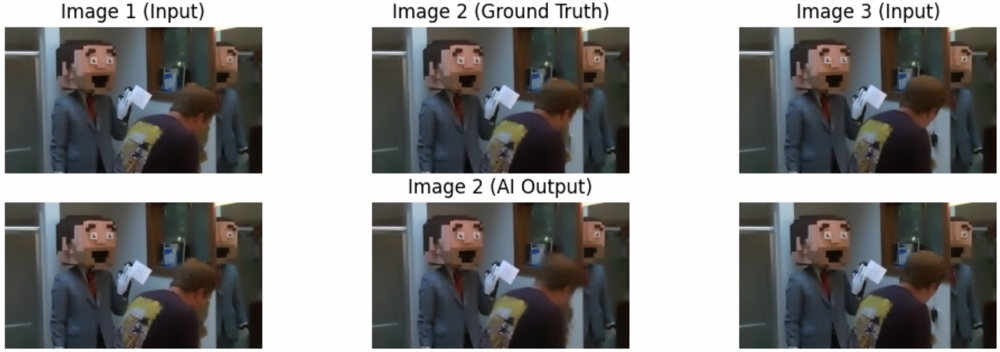
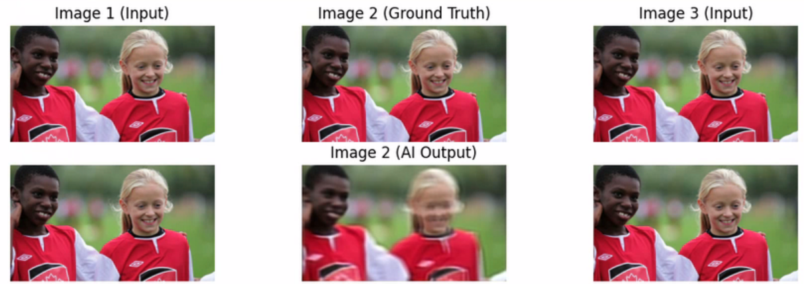
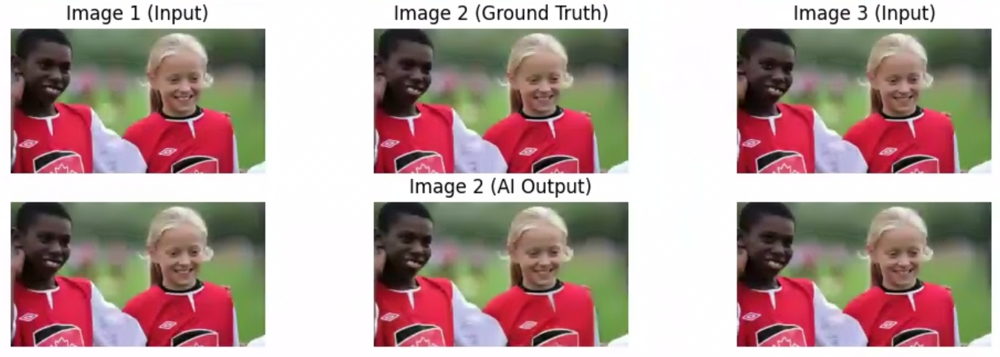
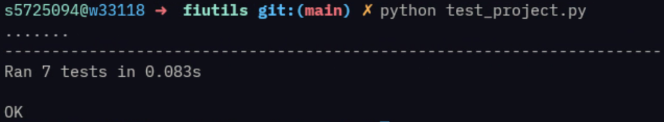

# Yasmina Abdallah (s5725094) ML Project

## Introduction

For my project I would like to develop a ML tool to automatically generate in-between frames.

The architectural design and approach were inspired by RIFE(Real-Time Intermediate Flow Estimation)(https://arxiv.org/pdf/2011.06294), though adapted here as a direct frame synthesis model rather than a flow-based one. This project implements a simplified Encoder-Decoder CNN.

While the current implementation is trained on the Vimeo-90K dataset for realistic footage, the long-term goal of this research is to specialize the model for 2D animation, addressing unique challenges such as non-linear motion, squash-and-stretch principles, and line-art consistency that are not present in live-action video.

## Main Approach

By utilising a Convolutional Neural Network (CNN) based on an Encoder-Decoder architecture, the system takes two input frames (start and end) and predicts the middle frame, smoothing out motion in video sequences and possibly animations.

## Key Datasets

I used the Vimeo-90K Dataset which can be found here: http://toflow.csail.mit.edu/

## Project Architecture

* **'FrameInterpolator.ipynb'**: The main notebook for downloading the data, preprocessing, training, and evaluating the model.

* **'Demo.ipynb'**: A deployment notebook featuring an interactive UI (using "ipywidgets") to allow users to upload images and generate in-betweens.

* **'Initial_Designs.ipynb'**: A notebook showcasing some of my initial designs, not a functional notebook!

* **'model.py'**: Defines the "FrameInterpolator" neural network architecture (PyTorch).

* **'FrameIntUtils.py'**: Custom utilities for dataset handling, image processing, and visualisation.

* **'test_project.py'**: Unit tests ensuring data integrity, model output shapes, and validation logic (TDD).

* **'requirements.txt'**: List of library dependencies.

## Installation & Setup
Ensure you have Python 3.x installed. You can install the required libraries using `pip` or `uv`.

```bash
# Using pip
pip install -r requirements.txt

# Using uv
uv add -r requirements.txt
```

Note: This project is optimized for CUDA. If running on a CPU-only machine, the code automatically adjusts, though inference will be slower.

## Usage

### Training the Model

Open FrameInterpolator.ipynb in Jupyter Lab. This notebook will:

1. Download the Vimeo-90K Interp test dataset (so be careful).

2. Split data into Train, Validation, and Test sets.

3. Train the Encoder-Decoder model.

4. Save the best model weights to best_frame_interpolator.pth.

### Running the Demo

Open Demo.ipynb in Jupyter Lab. Run all cells to launch the interactive widget:

1. Click "Upload Start Frame" and select a start image from your local drive.

2. Click "Upload End Frame" and select an end image from your local drive.

3. Click "Generate In-Between".

4. The system will display the start, generated middle, and end frames, along with a JavaScript GIF animation.

## Model Architecture

The model utilises a U-Net style Encoder-Decoder architecture:

* Encoder: 3 Convolutional blocks with ReLU activation and BatchNorm to extract spatial features and downsample input.

* Decoder: 2 Upsampling blocks with Bilinear interpolation and Convolutions to reconstruct the intermediate frame.

* Input: 6 channels (two RGB images concatenated).

* Output: 3 channels (one RGB image).

Initial model designs outputted very blurry images, my current model is a great improvement.





## Testing and Quality Assurance

This project follows Test Driven Development (TDD) principles. Run the unit tests in the fiutils folder:

```bash
python test_project.py
```

My result:



## Ethics

An ethics checklist regarding the use of this public dataset has been submitted via the Online Ethics Checklist found on the Bournemouth University website.
